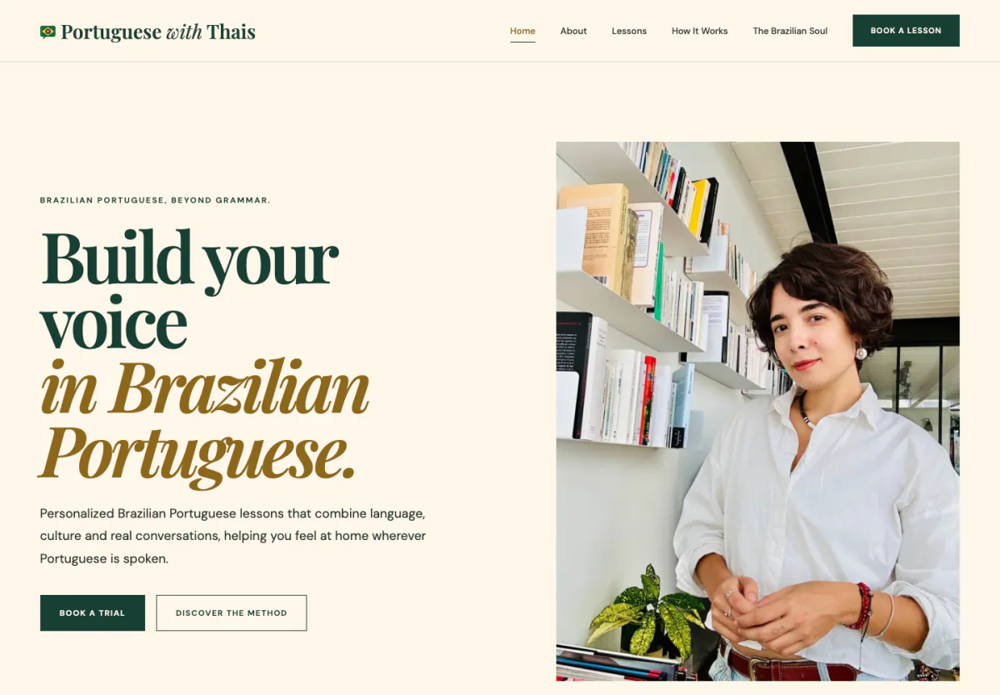
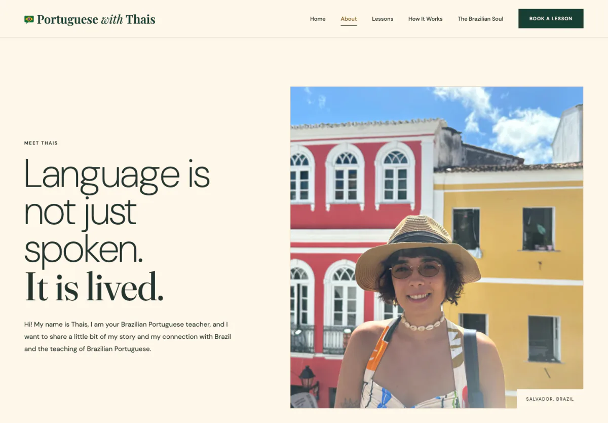
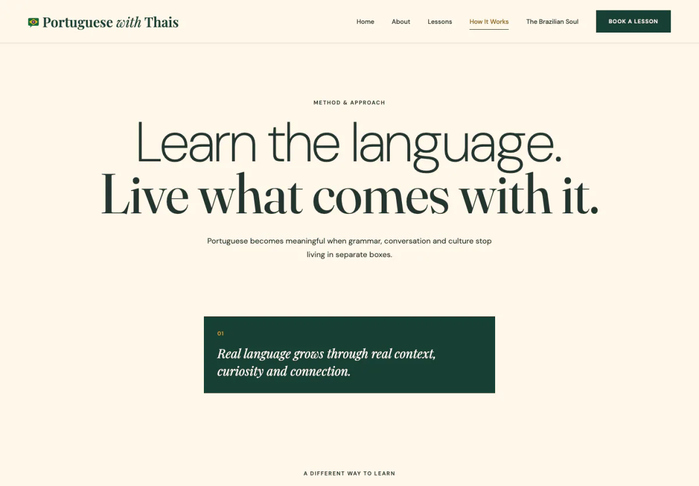
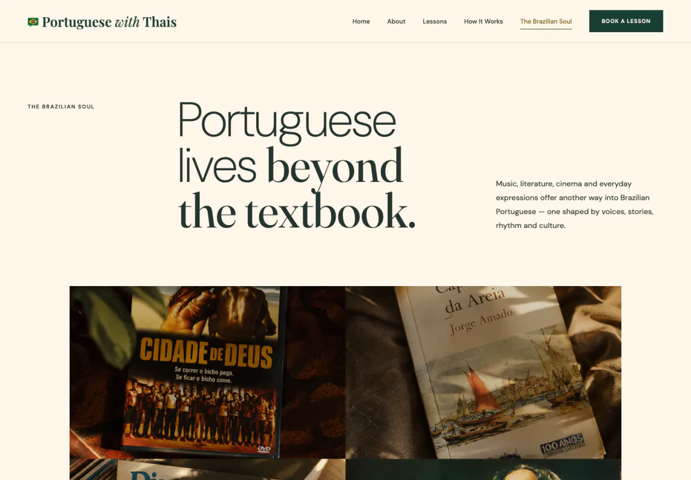
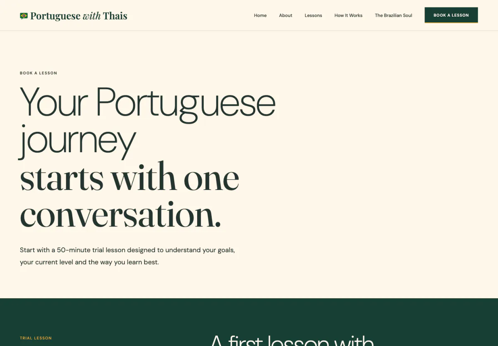
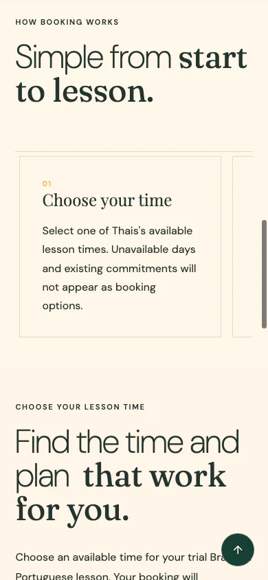

<h1 align="center">Portuguese with Thais</h1>

<p align="center">
  An editorial website for Brazilian Portuguese teacher <strong>Thais</strong>.<br />
  Explore her teaching approach, discover Brazilian culture and book a lesson.
</p>

<p align="center">
  <a href="https://portuguesewiththais.com"><strong>Visit the website</strong></a>
</p>

<p align="center">
  
  
  
  
  
  
</p>

## Overview

Portuguese with Thais introduces Thais, her teaching method and her private Brazilian Portuguese lessons. Visitors can compare lesson formats, take a placement test, explore a curated guide to Brazilian culture and choose a timeslot through Cal.com. The site is a static React single-page application. Cal.com handles scheduling and checkout outside the application.

## Screenshots

Captured from the local production build in Chrome at 1440 × 1000 for desktop and 390 × 844 for mobile. The desktop captures are resized for the README, and all captures are encoded as WebP. [Screenshot files](docs/screenshots/)

<table>
  <tr><th>Home</th><th>About</th></tr>
  <tr>
    <td></td>
    <td></td>
  </tr>
  <tr><th>Lessons</th><th>How It Works</th></tr>
  <tr>
    <td></td>
    <td></td>
  </tr>
  <tr><th>The Brazilian Soul</th><th>Book a Lesson</th></tr>
  <tr>
    <td></td>
    <td></td>
  </tr>
</table>

<p align="center">
  
  
  
</p>

## Features

- Six public pages with editorial photography, shared navigation and direct trial booking links, plus a fallback for unknown routes.
- Private lessons for adults and kids, CELPE-Bras preparation, pricing and a 30-question placement test.
- A cultural guide with music, a Spotify playlist, Brazilian literature, films and series, and everyday expressions.
- A keyboard-accessible mobile navigation dialog, visible focus indicators and native scroll-snap carousels on small screens.
- A single Cal.com booking embed with plan selection, direct booking links and WhatsApp contact.

## Stack

Versions below are resolved in the [frontend lockfile](frontend/package-lock.json).

| Area | Implementation |
| --- | --- |
| Interface | React and React DOM 19.2.8, JavaScript ES modules and JSX |
| Build | Vite 8.2.0, Vite React plugin 6.0.5 |
| Routing | React Router DOM 7.18.2 |
| Styling and icons | CSS Modules, global design tokens, React Icons 5.7.0 |
| Quality | ESLint 10.8.0, React Hooks and React Refresh lint rules, Playwright Test 1.63.0 |
| External services | Cal.com for booking and Spotify for the optional playlist |
| Hosting | Vercel static output with client-side routing |

## Repository structure

```text
portuguese-with-thais/
├── README.md
├── docs/
│   ├── DESIGN_SYSTEM.md          # Typography, colors and layout conventions
│   └── screenshots/             # Optimized README captures
└── frontend/
    ├── public/images/           # Published photos, responsive variants and branding
    ├── src/
    │   ├── assets/              # Bundled fonts and retained source photos
    │   ├── components/          # Shared controls, site layout and Home sections
    │   ├── hooks/               # Near-viewport loading for third-party embeds
    │   ├── pages/               # Route components and page-specific content
    │   ├── styles/              # Font declarations and design tokens
    │   ├── App.jsx              # Route definitions and shared layout
    │   └── main.jsx             # React entry point
    ├── tests/                   # Browser smoke tests and local Cal.com stub
    ├── index.html               # Initial HTML and crawler-visible metadata
    ├── package.json
    ├── package-lock.json
    ├── eslint.config.js
    ├── playwright.config.js
    ├── vercel.json              # SPA fallback for deep links
    └── vite.config.js
```

## Architecture and routes

React Router renders pages inside a shared header and footer. Page-specific sections keep their markup, CSS Modules and local content together. The placement test runs in the browser with local question data. Shared components handle route metadata, hash scrolling, scroll reveals and mobile scroll-snap regions. The site has no application server or database.

| Page | Path |
| --- | --- |
| Home | `/` |
| About | `/about` |
| Lessons | `/lessons` |
| How It Works | `/method` |
| The Brazilian Soul | `/the-brazilian-soul` |
| Book a Lesson | `/book-a-lesson` |

## Booking with Cal.com

The [plan map](frontend/src/pages/BookLesson/bookingPlans.js) links each plan to its Cal.com event. A Trial Lesson and a Single Session each book one 50-minute lesson. Flow, Pace and Mastery include 4, 8 and 12 lessons, respectively.

Students pay for a package upfront and book its first lesson through the embed. They arrange the remaining lessons directly with Thais and renew manually by buying another package through the site. The frontend has no subscription or package-balance system.

The trial shortcut points to `/book-a-lesson?plan=trial#booking`. The booking page loads the calendar near the viewport, or immediately for a booking deep link. Plan changes replace the mounted iframe, while a direct Cal.com link gives visitors another way to open the selected event. [Booking component](frontend/src/pages/BookLesson/sections/BookingEmbed/BookingEmbed.jsx)

Thais manages payments, cancellation settings, availability, notifications and video conferencing in the external booking services. The site presents the booking policy and links to these events. Live payment transactions, refunds and confirmation delivery require separate verification.

## SEO, images and fonts

- Initial titles, descriptions, canonical URLs and Open Graph and Twitter metadata are in [index.html](frontend/index.html). The shared social card is a 1200 × 630 JPEG served under `/images/social/thais-portrait-social.jpg`.
- React updates titles, descriptions and canonical URLs from [route metadata](frontend/src/components/common/RouteMetadata/metadataConfig.js). Non-JavaScript crawlers receive the shared initial HTML on deep links.
- Key photos use responsive WebP candidates, explicit dimensions, `srcSet` and `sizes`. Primary hero images load eagerly with high priority. Below-the-fold images and third-party embeds use deferred loading where appropriate.
- Playfair Display, DM Sans, Fraunces and Manrope are self-hosted as variable WOFF2 fonts with `font-display: swap`. Font declarations and design tokens live in [frontend/src/styles](frontend/src/styles).

## Local development

Use Node.js 20.19+, 22.13+ on the 22.x line, or Node.js 24+, with npm. These ranges account for both Vite and ESLint. The frontend needs no local environment variables or credentials. External embeds need an internet connection.

```sh
git clone https://github.com/lorenasferreira/portuguese-with-thais.git
cd portuguese-with-thais/frontend
npm ci
npm run dev
```

Vite prints the development address, usually `http://localhost:5173`. To inspect the production build locally, run:

```sh
npm run build
npm run preview
```

## Deployment

Use `frontend/` as the Vercel project root, `npm run build` as the build command and `dist/` as the output directory. The [Vercel configuration](frontend/vercel.json) rewrites deep links to `index.html` so React Router can resolve the path. Unknown paths render the 404 page with the shared header and footer. The SPA fallback can still return HTTP 200 for those paths. After release, verify that direct route URLs work and the production social image returns HTTP 200 with an image content type.

## Quality checks

From `frontend/`, run:

```sh
npm run lint
npm run build
git diff --check
```

### Automated browser tests

From `frontend/`, install Chromium once, then run the suite.

```sh
npx playwright install chromium
npm test
```

To use an already installed Chromium-based browser, set `PLAYWRIGHT_CHROMIUM_PATH` to its executable path when running `npm test`. The suite starts its own Vite development server on `127.0.0.1:4179`.

The tests visit all six routes through the header at 320px, 390px, 768px and 1440px, check for horizontal overflow, and exercise mobile keyboard navigation, dialog focus and Escape. A separate test covers direct navigation to an unknown path, refresh and keyboard return to Home. The booking test follows the trial CTA, switches through all five plans and verifies a single correctly configured iframe after each selection. The suite serves a Cal.com stub locally and blocks external requests. It never contacts the live booking account or submits a payment. [Test source](frontend/tests/site.spec.js)

### Manual browser review

Use the production preview to review layout and typography, image loading, the placement test, touch scrolling, and keyboard focus states. Check initial HTML and route metadata, the favicon and the social image response. For release verification, review the live calendar separately without submitting a booking or payment.

## Maintenance

- Update the booking plan map, visible prices and booking-policy copy together when an offer changes. Confirm the corresponding external Cal.com event and its settings with Thais.
- Keep production images grouped by purpose. Preserve responsive image widths, intrinsic dimensions and meaningful alt text when replacing a photograph. Keep source-only photos outside `public/`.
- If the domain or social image changes, update the initial HTML and route metadata together. Use fresh production-preview captures when the README screenshots no longer reflect the interface.
- Use the [design system](docs/DESIGN_SYSTEM.md) for visual changes and retain the existing font notices under [frontend/src/assets/fonts](frontend/src/assets/fonts).

## Credits

Designed and developed by **[Lorena Ferreira](https://lorenaferreira.dev)** for **Portuguese with Thais**.
